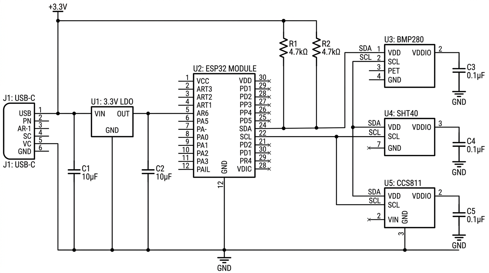

<div align="center">

# 🌡️ EnviroNode

**ESP32-S3 IoT environmental sensor board: temperature, humidity, pressure, and air quality over Wi-Fi and BLE.**


[Overview](#-overview) · [Specs](#-specifications) · [Design highlights](#-design-highlights) · [Repository contents](#-repository-contents) · [Known issues](#-known-issues) · [Credits](#-credits-and-license)

</div>

---

## 📖 Overview

EnviroNode is a compact **4-layer, USB-C powered** sensor node built around the **ESP32-S3-WROOM-1**. Three I2C sensors share one bus: a **BMP280** (pressure and temperature), an **SHT40** (humidity), and a **CCS811** (eCO2 and TVOC). The design targets JLCPCB manufacturing and LCSC-sourced parts.

This repository is a fork of the original *IoT Environmental Sensor Board* design by **Brad Barroso** (see [Credits](#-credits-and-license)).

<p align="center">
  <br>
  <sub>Schematic overview (simplified illustration)</sub>
</p>

## 📋 Specifications

| Parameter | Value |
|-----------|-------|
| MCU | ESP32-S3-WROOM-1 (N8R2): 8 MB flash, 2 MB PSRAM |
| Sensors | BMP280 (pressure/temp), SHT40 (humidity), CCS811 (eCO2/TVOC) |
| Power | USB-C 5 V into AP2112K-3.3 LDO (600 mA) |
| Connectivity | Wi-Fi 802.11 b/g/n, BLE 5.0 |
| PCB | 4-layer, 1.6 mm FR4, ENIG |
| Dimensions | 45 mm × 32 mm |
| I2C | Single bus at 400 kHz, 4.7 kΩ pull-ups on SDA and SCL |
| Current budget | ~85 mA active (Wi-Fi TX), ~15 µA deep sleep (design target) |

## ⚡ Design highlights

### Power
- USB-C input with **USBLC6-2SC6** ESD protection
- **AP2112K-3.3** LDO chosen over AMS1117: 250 mV dropout, 55 µA quiescent current, ceramic-capacitor stable
- Worst-case LDO dissipation about 145 mW (5 V to 3.3 V at 85 mA), estimated junction temperature about 63 °C
- 100 nF decoupling at each IC, 10 µF bulk capacitors on the LDO input and output

### Sensor bus
- Addresses: BMP280 `0x76`, SHT40 `0x44`, CCS811 `0x5A`
- 4.7 kΩ pull-ups sit inside the calculated 400 kHz range (about 0.97 kΩ to 14.2 kΩ for roughly 25 pF of bus capacitance)

### Layout
| Layer | Purpose |
|-------|---------|
| F.Cu | Signals and components |
| In1.Cu | Continuous GND plane |
| In2.Cu | 3.3 V power plane |
| B.Cu | Signals and I2C routing |

- Moved from 2 to 4 layers for an unbroken ground reference and a dedicated 3.3 V plane
- CCS811 placed at the board edge with a via-stitched ground guard ring and a copper keepout at the gas inlet
- 2×2 array of thermal vias under the ESP32-S3 ground pad
- SHT40 placed at the board edge away from the MCU to limit self-heating bias

Full rationale, rejected alternatives, and calculations are in [`docs/design-notes.md`](docs/design-notes.md).

## 🗂️ Repository contents

```
enviro-node-esp32s3/
├── hardware/
│   └── schematic/
│       ├── iot-sensor-board.kicad_sch   # Top-level schematic
│       └── power-supply.kicad_sch       # USB-C to 3.3 V power stage
├── docs/
│   ├── BOM.csv                          # Bill of materials with LCSC part numbers
│   └── design-notes.md                  # Design decisions, revision history, known issues
├── images/                              # Illustrations used in this README
└── README.md
```

**Not included in this repository:** the PCB layout (`.kicad_pcb`), Gerber and drill files, design-rule file, the I2C sensor-interface sheet, and any simulation outputs. Add them here when available.

## 🛒 Bill of materials

`docs/BOM.csv` lists the 18 line items with manufacturer part numbers and LCSC codes. Key parts:

| Ref | Part | Role |
|-----|------|------|
| U1 | ESP32-S3-WROOM-1-N8R2 | Wi-Fi + BLE 5 MCU module |
| U2 | AP2112K-3.3TRG1 | 3.3 V LDO |
| U3 | USBLC6-2SC6 | USB ESD protection |
| U4 | BMP280 | Pressure and temperature |
| U5 | SHT40-AD1B | Humidity and temperature |
| U6 | CCS811B-JOPD33 | eCO2 and TVOC |
| J1 | GCT USB4105-GF-A | USB-C receptacle |

## 🧯 Known issues

1. **SHT40 self-heating:** nearby ESP32 activity can bias humidity readings by +2 to 3 %RH.
2. **CCS811 burn-in:** needs about 48 hours of continuous operation to establish its baseline.
3. **USB-C orientation:** only CC1 is populated, so cable flip is not detected. Acceptable for power-only USB.

## 🗒️ Revision history

| Rev | Date | Changes |
|-----|------|---------|
| 1.0 | 2025-11-20 | Initial 2-layer design with AMS1117-3.3 |
| 2.0 | 2026-02-08 | 4-layer migration, AP2112K LDO, CCS811 added |
| 2.1 | 2026-04-15 | SHT40 footprint pad spacing fixed, ground stitching improved |

## 🙌 Credits and license

- **Original design:** Brad Barroso (credited in the schematic title blocks, which are left unchanged)
- **Fork maintained by:** [Sharanya S (Shine)](https://github.com/sharanyasrinivas-jfk)

Hardware: [CERN-OHL-S-2.0](https://ohwr.org/cern_ohl_s_v2.txt). Documentation: [CC BY-SA 4.0](https://creativecommons.org/licenses/by-sa/4.0/). Both licenses require attribution to the original author and sharing derivatives under the same terms.

> The images in `images/` are illustrations, not exports from the KiCad project files.
